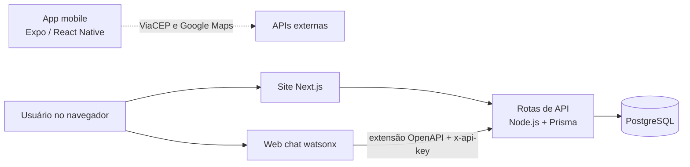

# ♻️ ReUse!

Plataforma colaborativa de **trocas e doações de objetos** entre pessoas de Osasco e região. A ideia é incentivar o consumo consciente e a economia circular: o que está parado na casa de um ganha uma nova vida na casa de outro, sem gerar resíduo.

Projeto do 2º ano da FIAP, construído ao longo de seis fases.

## 🔗 Links

| O quê | Endereço |
|---|---|
| Site (frontend Next.js) | https://reuse.obrian.me |
| API (backend) | https://reuse.obrian.me/api/itens, que aceita `?busca=` |
| Assistente virtual (IBM watsonx) | Botão de chat no canto do site |

## 🧭 As fases do projeto

| Fase | Entrega | Onde está |
|---|---|---|
| 01 | Wireframes e protótipos web e mobile | Figma do grupo |
| 02 | App mobile em React Native, animações e plano de gamificação | Raiz deste repositório (`app/`, `src/`) |
| 03 | Evolução do app mobile | Raiz deste repositório |
| 04 | Plano de marketing digital | Documento do grupo |
| 05 | Full stack: frontend Next.js e backend Node.js com Prisma e PostgreSQL | [`web/`](web) |
| 06 | Chatbot no IBM watsonx e área administrativa low code | Chatbot em [`assistant/`](assistant) e nas rotas `web/app/api/assistant/` |

## 🏗️ Arquitetura



- **Frontend e backend no mesmo projeto Next.js**:
  - as páginas (`web/app/page.tsx`, `web/app/criar`, `web/app/itens/[id]`) são o frontend;
  - as rotas de API (`web/app/api/...`) são o backend, rodando em Node.js com Prisma.
- **Banco**: PostgreSQL 17.
- **Assistente**: o watsonx executa tarefas pela API (buscar itens, listar "meus anúncios", anunciar, pausar, reativar e registrar troca) e orienta o usuário (como anunciar, como funciona a troca, regras e segurança). Detalhes em [`assistant/README.md`](assistant/README.md).

## 📱 App mobile (raiz do repositório)

Expo Router com React Native:
- onboarding com carrossel animado e login;
- abas **Home**, **Explorar** (busca de endereço por CEP no ViaCEP e mapa), **Publicar** (foto pela câmera ou pela galeria), **Chat** e **Perfil** (pontos da gamificação).

```bash
npm install
npx expo start
```

Abra no celular pelo app Expo Go, lendo o QR code, ou aperte `w` para a versão web.

## 🌐 Site e API ([`web/`](web))

Next.js 16, Prisma Next e PostgreSQL. Telas:
- catálogo com filtros por categoria e métrica de CO₂ evitado;
- página do item;
- criação de anúncio.

| Rota | Método | O que faz |
|---|---|---|
| `/api/itens` | GET | Lista os itens disponíveis; `?busca=` filtra por texto |
| `/api/assistant/items` | GET, POST | Busca e publica itens pelo assistente |
| `/api/assistant/my-items` | POST | Lista os anúncios de um e-mail |
| `/api/assistant/my-items/pause`, `resume`, `mark-traded` | POST | Pausa, reativa ou marca o anúncio como trocado |

As rotas `/api/assistant/*` exigem o cabeçalho `x-api-key`.

Para rodar em desenvolvimento, com um PostgreSQL local e a `DATABASE_URL` em `web/.env`:

```bash
cd web
npm install
npm run dev
```

Dados de demonstração: `node scripts/seed.mjs`.

## 🚀 Deploy

- **Onde roda**: numa VPS, em Docker Compose (app e PostgreSQL), atrás do Nginx com HTTPS (Let's Encrypt).
- **Segredos**: só no `.env` do servidor.
- **Como publicar**: `DEPLOY_HOST=usuario@servidor ./web/deploy.sh` envia a pasta `web/` e reconstrói o container.

## 👥 Grupo

Brian Henrique Dantas Portela, Kauanny Teles Batista e Rebeca Luana Tavares Rodrigues Vicente.
