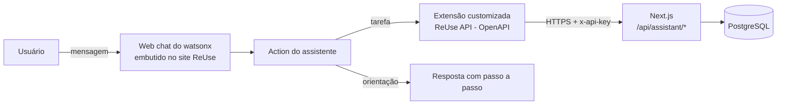

# Assistente virtual do ReUse! (IBM watsonx Assistant)

Chatbot da plataforma ReUse! criado no **IBM watsonx Assistant** (nova experiência, com *actions*). Ele tem dois papéis:

1. **Executar tarefas na plataforma**: pausar e reativar ofertas, listar anúncios, publicar um item pela conversa, registrar uma troca e buscar itens. O assistente chama a API do ReUse por uma **extensão customizada (OpenAPI)**, o mesmo recurso que a IBM usa para integrar o watsonx.ai.
2. **Orientar o usuário**: respostas com passo a passo sobre como anunciar, como funciona uma troca, busca, regras, segurança e mais.

- Plataforma publicada: https://reuse.obrian.me
- Atividade 02 da Fase 6 (FIAP, 2º ano): *ReUse com voz: criando um assistente virtual com IBM Watson*

## Arquitetura



Cada endpoint devolve o campo `message` já pronto para exibir. Assim, cada *action* de tarefa só precisa mostrar `body.message`, e as regras de negócio ficam no código, não espalhadas pelos passos do chatbot.

## Tarefas automatizadas

| Action | Exemplos do que o usuário diz | Endpoint | O que acontece |
| --- | --- | --- | --- |
| Pausar minhas ofertas | "quero pausar minhas ofertas ativas", "vou viajar, pausa tudo" | `POST /api/assistant/my-items/pause` | Pede confirmação e muda todos os anúncios ativos para **pausado**. Eles saem do catálogo. |
| Reativar minhas ofertas | "reativar minhas ofertas", "despausar meus itens" | `POST /api/assistant/my-items/resume` | Devolve os anúncios pausados ao catálogo. |
| Meus anúncios | "quais itens eu anunciei?", "status dos meus anúncios" | `POST /api/assistant/my-items` | Lista os anúncios com código e status (ativo, pausado ou trocado). |
| Anunciar um item | "quero anunciar um item", "quero doar um objeto" | `POST /api/assistant/items` | Coleta título, categoria, estado e descrição, mostra o resumo, confirma e publica. |
| Registrar uma troca | "já troquei meu item", "marcar como trocado" | `POST /api/assistant/my-items` e `.../mark-traded` | Mostra os anúncios, pede o código e marca o item como **trocado**. |
| Buscar itens | "procurar uma bicicleta", "tem cadeira disponível?" | `GET /api/assistant/items` | Busca itens ativos e devolve até 5, com link para o anúncio. |
| Usar outro e-mail | "esse não é meu e-mail" | (nenhum) | Troca o e-mail guardado na sessão. |

O usuário é identificado pelo **e-mail da conta**. O assistente pergunta o e-mail só na primeira tarefa da conversa e guarda na variável de sessão `email_usuario` (com *privacy* ligado, para não aparecer nos logs). O site usa o mesmo e-mail no formulário de anúncio, então "meus anúncios" é igual no site e no chat.

## Orientações ao usuário

| Action | Exemplos | Conteúdo |
| --- | --- | --- |
| Como anunciar um item | "como cadastrar um novo item para troca?" | Passo a passo no site e no app, com o botão "Quero anunciar agora". |
| Como funciona uma troca | "como faço uma troca", "o reuse é para vender?" | Do interesse ao registro da troca, em 5 etapas. |
| Como buscar e filtrar itens | "como encontro itens perto de mim" | Busca por palavra, categorias, aba Explorar do app (CEP e mapa). |
| Estados de conservação | "diferença entre excelente e bom" | Quando usar Novo, Excelente, Bom ou Regular. |
| Dicas para um bom anúncio | "meu anúncio não tem interessados" | Título, descrição, fotos e tempo de resposta. |
| O que posso anunciar | "posso vender no reuse?" | O que é aceito e o que é proibido. |
| Dicas de segurança | "como evitar golpes" | Cuidados no encontro e na conversa. |
| Pausar, reativar ou encerrar anúncios | "como tiro meu item do ar" | Explica cada status e oferece fazer na hora. |
| Conta e cadastro | "como me cadastro" | Cadastro no app e identificação por e-mail no site. |
| Impacto ambiental e pontos | "o que é a economia de CO2" | Métrica de 14,5 kg de CO₂ por item e pontos do perfil. |
| O que o assistente sabe fazer | "ajuda", "menu" | Lista de tarefas e assuntos, com botões. |
| Saudação, "Não entendi", Ajuda extra e Agradecimento | (sistema) | Boas-vindas com menu, nova tentativa com opções e encerramento. |

## Arquivos

| Arquivo | Para que serve |
| --- | --- |
| [`reuse-openapi.json`](reuse-openapi.json) | Especificação OpenAPI 3.0 importada na extensão customizada do watsonx Assistant. |
| [`build_actions.py`](build_actions.py) | Roteiro de toda a conversa (textos, passos, condições e chamadas) em Python; gera o JSON de *actions*. |
| `reuse-actions.json` | *Actions* geradas, prontas para upload no watsonx Assistant. |
| [`../web/app/api/assistant`](../web/app/api/assistant) | Endpoints chamados pelo assistente. |
| [`../web/app/WatsonChat.tsx`](../web/app/WatsonChat.tsx) | Web chat do watsonx embutido em todas as páginas do site. |

## Como configurar no watsonx Assistant

Em 2026 o watsonx Assistant passou a fazer parte do **watsonx Orchestrate**, com o nome **AI assistant builder**. A entrada antiga do catálogo só oferece o plano Enterprise. Para conta acadêmica (Trial da IBM Cloud com Promocode), o caminho gratuito é o watsonx Orchestrate no plano **Trial**: 30 dias de acesso ao plano Standard (90 para domínios educacionais), oferecido na região **Sydney (au-syd)**.

### 1. Criar a instância e o assistente

1. Catálogo da IBM Cloud > **watsonx Orchestrate** > localização **Sydney (au-syd)** > plano **Trial** > aceitar os termos > **Criar**.
2. **Launch watsonx Orchestrate** > menu > **Active inventory** > **Assistants** (abre o AI assistant builder).
3. Crie o assistente com idioma **Brazilian Portuguese**. Na tela de boas-vindas o campo de idioma continua mostrando "English (US)" mesmo depois da troca; prefira criar pelo seletor de assistentes (**Create new**) e confira o idioma em *Assistant settings*, porque ele não muda depois.

### 2. Criar a extensão "ReUse API"

1. **Integrations** > **Build custom extension** > *Next*.
2. Nome: `ReUse API` > *Next*.
3. Importe [`reuse-openapi.json`](reuse-openapi.json) > *Next* > *Finish*.
4. No card da extensão, **Add** > *Add* > *Next*.
5. **Authentication type**: `API key auth`. **API key**: o valor de `ASSISTANT_API_KEY` do `.env` do servidor. Servidor `https://reuse.obrian.me` > *Next* > *Finish*.

### 3. Gerar e carregar as actions

O gerador precisa de dois dados da instância:

- **`--base`**: o download das actions (*Actions* > engrenagem *Global settings* > **Upload/Download** > **Download**), salvo como `assistant/base-export.json` (fora do Git). Dele vêm as configurações globais e as actions de sistema.
- **`--catalog-item-id`** e **`--spec-hash-id`** da extensão: aparecem na resposta de `GET /mfe_assistants/rest/v2/assistants/<assistant_id>/catalog/integrations`, que o próprio AI assistant builder chama (aba *Network* do navegador). Outra opção é criar à mão uma action que use a extensão antes do download; o gerador lê os IDs dela.

```bash
python assistant/build_actions.py --base assistant/base-export.json --out assistant/reuse-actions.json   --catalog-item-id <catalog_item_id> --spec-hash-id <spec_hash_id>
```

Depois, em *Global settings* > **Upload/Download** > **Upload**, envie `reuse-actions.json` (substitui todas as actions) e aguarde o treino terminar. O import valida duas regras que o gerador já cumpre: as actions formam uma corrente única de `next_action` (`welcome` → actions criadas → `fallback` → `run_always` → `anything_else`) e toda entidade de sistema usada (`sys-number`, `sys-yes-no`) é declarada.

### 4. Web chat no site

1. **Integrations** > **Web chat** > ambiente **Draft**.
2. *Style*: nome `Assistente ReUse!`, cores `#1A4632`, `#278753` e `#19E65E`.
3. *Home screen*: **Off**, para a conversa abrir com a saudação em português e o menu das actions.
4. Aba **Embed**: copie `integrationID`, `region` (no AI assistant builder é uma URL) e `serviceInstanceID` para o `.env` do servidor como `WATSON_INTEGRATION_ID`, `WATSON_REGION` e `WATSON_SERVICE_INSTANCE_ID` e rode `docker compose up -d`. São identificadores públicos: aparecem no HTML de qualquer site com o widget.

## Roteiro de testes

| Mensagem | Resultado esperado |
| --- | --- |
| `oi` | Boas-vindas com o menu de opções. |
| `quero pausar minhas ofertas ativas` → e-mail → `sim` | "Feito! Pausei N ofertas..." e os itens somem do catálogo. |
| `reativar minhas ofertas` | Não pede o e-mail de novo; "Prontinho! Reativei N ofertas...". |
| `quero anunciar um item` → título → categoria → estado → descrição → `sim` | "Pronto! Seu anúncio ... foi publicado" com link. |
| `já troquei meu item` → código | Lista os anúncios, depois "Parabéns pela troca!". |
| `tem bicicleta disponível?` → `bicicleta` | Lista com link para cada anúncio. |
| `como cadastrar um novo item para troca?` | Passo a passo no site e no app. |
| `posso vender no reuse?` | Regras do que pode ser anunciado. |
| `asdfgh` | "Hmm, não entendi" com opções. |

Usuários de demonstração (criados por `web/scripts/seed.mjs`): `clara@reuse.demo` e `esteves@reuse.demo`.

## API

Todas as rotas exigem o header `x-api-key`. Resultados de negócio voltam com HTTP 200 (`ok` e `message`); dados inválidos, com 400; chave errada, com 401.

```bash
curl -H "x-api-key: $ASSISTANT_API_KEY" "https://reuse.obrian.me/api/assistant/items?query=bicicleta"

curl -X POST -H "x-api-key: $ASSISTANT_API_KEY" -H "content-type: application/json" \
  -d '{"email":"clara@reuse.demo"}' https://reuse.obrian.me/api/assistant/my-items/pause
```

## Rodar localmente

```bash
cd web
npm install
# .env com DATABASE_URL, ASSISTANT_API_KEY e PUBLIC_BASE_URL=http://localhost:3000
npx prisma db init
node scripts/seed.mjs
npm run dev
```

Publicação no servidor: `DEPLOY_HOST=usuario@servidor ./web/deploy.sh` (Docker Compose com app e PostgreSQL; ver [`web/docker-compose.yml`](../web/docker-compose.yml)).
